# Awesome Desktop Automation & Autonomous OS Agents 🤖 💻 [](https://github.com/ishandutta2007/Awesome-Awesome-Awesome)

<p align="center">
  
</p>

> 🚀 A comprehensive, curated directory of **Autonomous OS Agents**, **Computer-Use AI (CUA)**, **Desktop Automation Frameworks**, **Multimodal GUI Agents**, and **AI Browser Automation Runtimes**.

<p align="left">
  <a href="https://github.com/ishandutta2007/Awesome-Awesome-Awesome"></a><a href="https://discord.gg/jc4xtF58Ve"></a>
  <a href="https://github.com/ishandutta2007/Awesome-Desktop-Automation-Autonomous-OS-Agents/stargazers"></a>
  <a href="https://github.com/ishandutta2007/Awesome-Desktop-Automation-Autonomous-OS-Agents/network/members"></a>
  <a href="https://github.com/ishandutta2007/Awesome-Desktop-Automation-Autonomous-OS-Agents/pulls"></a>
  <a href="https://opensource.org/licenses/MIT"></a>
  <a href="https://github.com/ishandutta2007"></a>
</p>

---

## 📖 Overview

Welcome to the definitive ecosystem index tracking **Autonomous OS Agents**, **Computer-Using Agents (CUA)**, **Vision-Language Desktop Controllers**, and **Headless Cloud Browser Grids**! 🌐

These autonomous systems perceive graphical user interfaces (GUIs) across macOS, Windows, and Linux via Vision-Language Models (VLMs) and accessibility trees, and orchestrate mouse clicks, keyboard keystrokes, and complex multi-app workflows. 🎯

Whether you are engineering next-generation Robotic Process Automation (RPA), autonomous web-scraping pipelines, self-healing automated QA suites, or self-operating desktop environments, this index organizes both commercial cloud platforms and cutting-edge open-source projects. 🛠️

---

## 📑 Table of Contents

- [📊 Sector Overview & Market Dynamics](#-sector-overview--market-dynamics)
- [☁️ SaaS & Hosted Platforms](#️-saashosted-platforms)
- [🔓 Open-Source GitHub Projects](#-open-source-github-projects)
- [🏗️ Key Architectural Patterns](#️-key-architectural-patterns)
- [📈 Star History](#-star-history)
- [🤝 How to Contribute](#-how-to-contribute)
- [💖 Support](#-support)
- [⚠️ Disclaimer](#️-disclaimer)

---

## 📊 Sector Overview & Market Dynamics

The global **Autonomous AI Agents & Computer-Use** market is valued at approximately **$5.8B – $10.5B in 2025–2026** and is accelerating at an unprecedented compound annual growth rate (**CAGR of 40% – 46%**), projected to eclipse **$52B – $70B by 2030**. 📈

The sector exhibits **moderate fragmentation with aggressive foundational consolidation**: frontier AI hyperscalers (Microsoft, OpenAI, Anthropic, Amazon) anchor the underlying vision-reasoning models and cloud VM runtime layers in a winner-take-most dynamic, while specialized vertical startups and open-source ecosystems rapidly proliferate across niche execution runtimes, stealth browser grids, and sandboxed OS virtualization. ⚡

---

## ☁️ SaaS/Hosted Platforms

The following SaaS and hosted platforms provide managed infrastructure, cloud browser farms, or turnkey computer-operating agents. Sorted in descending order by company scale (market valuation / enterprise capitalization). 🏢

| Product / Platform | Company Size (Valuation / Revenue) | Pricing (Starting Paid Tier) | Free Tier / Trial Limits | Description & Capabilities |
| :--- | :--- | :--- | :--- | :--- |
| **[Playwright Cloud (Microsoft Azure Playwright Workspaces)](https://playwright.dev)** | **$3.1T+** Market Cap (Microsoft) | **$0.012 per test minute** (Pay-as-you-go via Azure) | **30-day free trial** with **100 test minutes** included per Azure subscription | Enterprise-grade managed cloud browser infrastructure scaling Playwright suites across hosted Windows and Linux VMs. |
| **[Anthropic Computer Use (Claude API)](https://anthropic.com)** | **$60B+** Valuation | **$3.00 / $15.00 per 1M tokens** (Claude 3.5 Sonnet / Claude 3.7) | **$5 free credit** upon API registration (expires in 14 days) | Direct multimodal screen-parsing & desktop control API allowing Claude to inspect screenshots, move cursors, and click UI elements. |
| **[Operator by OpenAI (ChatGPT Agent)](https://openai.com)** | **$157B** Valuation | **$20.00 / month** (ChatGPT Plus) / **$200.00 / month** (Pro) | **Free forever plan** with standard ChatGPT search/voice; Operator preview includes trial tasks for Plus/Pro | Cloud browser-operating autonomous agent powered by Computer-Using Agent (CUA) vision models for multi-step web task execution. |
| **[Adept / Adequate (Adept AI)](https://adept.ai)** | **$1B** Peak Valuation (~$415M funded; tech licensed to Amazon) | **Custom Enterprise contract** (Technology licensed by Amazon AGI) | **30-day POC / Developer preview trial** on enterprise request | Action-oriented AI models trained on UI interaction to navigate complex multi-app enterprise desktop and web software. |
| **[Browserbase](https://browserbase.com)** | **$300M** Valuation ($67.5M funded) | **$20.00 / month** (Developer Plan; $99.00 / month Startup) | **Free forever plan**: **1 browser hour/month**, up to 3 concurrent sessions, 15 min max session duration | Managed serverless headless browser platform built for AI agents with session replay, stealth proxies, and Stagehand SDK. |
| **[MultiOn](https://multion.ai)** | **$100M** Valuation ($20M+ Series A) | **$20.00 / month** (Personal / Pro Tier) | **Free forever plan**: **100 free agent requests/month** with basic API rate limits | Cloud AI agent platform and Chrome extension translating natural-language commands into autonomous browser workflows. |
| **[Lindy](https://lindy.ai)** | **$50M+** Funding (Battery & Menlo) | **$29.99 / user / month** (includes shared pool of 3,000 credits) | **7-day free trial** with **$50 worth of free credits** (no credit card required) | No-code autonomous assistant builder handling cross-app workflows, email triage, calendar tasks, and browser automation. |
| **[Simular (Sai)](https://simular.ai)** | **$27M** Total Funding ($21.5M Series A) | **$50.00 / month** (Starter plan; $500.00/mo Unlimited) | **Free forever plan ("Explore")**: Daily refreshed credits with limited cloud Windows computer access | Autonomous personal computer-use agent executing complex desktop app navigation, file manipulation, and browser workflows. |
| **[Induced AI](https://induced.ai)** | **$2.3M+** Seed Funding (Sam Altman, Peak XV) | **$49.00 / month** (Starter tier; $199.00/month Scale) | **Free trial credits**: Access via `browse.new` with trial minutes (no credit card required) | Cloud autonomous browser-worker turning natural-language SOPs into parallel headless browser sessions with human-like interactions. |
| **[HyperWrite](https://hyperwriteai.com)** | **$5.4M+** Funding (OthersideAI) | **$19.99 / month** (Premium; $44.99 / month Ultra) | **Free forever plan**: Starter tier with basic AI messages and document editor access | Personal AI assistant featuring an autonomous Chrome browser agent executing web research, data extraction, and form fills. |

---

## 🔓 Open-Source GitHub Projects

Explore the premier open-source frameworks, desktop sandboxes, and browser drivers power-charging autonomous agents. Repositories are ordered in descending rank by GitHub Stars_Count. 🌟

| Project & Repo Link | GitHub_Stars | Core Language / Stack | Primary Focus & Category | Key Features & Notes |
| :--- | :---: | :--- | :--- | :--- |
| **[browser-use](https://github.com/browser-use/browser-use)** | [](https://github.com/browser-use/browser-use/stargazers) | Python / Playwright | Autonomous Web Agent | Connects any LLM (OpenAI, Anthropic, DeepSeek, Ollama) to Playwright for multi-tab web navigation, form handling, and extraction. |
| **[Playwright](https://github.com/microsoft/playwright)** | [](https://github.com/microsoft/playwright/stargazers) | TypeScript / Python / C# | Core Browser Automation Engine | The industry standard for Chromium, Firefox, and WebKit automation; foundational execution layer for modern AI web agents. |
| **[Open Interpreter](https://github.com/openinterpreter/open-interpreter)** | [](https://github.com/openinterpreter/open-interpreter/stargazers) | Python | Local Computer & OS Control | Open-source natural language interface enabling LLMs to execute code locally and operate desktop applications via `OS Mode`. |
| **[UI-TARS Desktop](https://github.com/bytedance/UI-TARS-desktop)** | [](https://github.com/bytedance/UI-TARS-desktop/stargazers) | Python / TypeScript | Multimodal GUI OS Agent | ByteDance's vision-language GUI agent application offering native mouse/keyboard control across macOS, Windows, and browsers. |
| **[Cua — Computer-Use Agent](https://github.com/trycua/cua)** | [](https://github.com/trycua/cua/stargazers) | Python / Swift / Shell | Sandboxed Virtualized OS Runtime | High-performance macOS & Linux virtual machine sandbox runtime (`Lume`) designed for safely running and benchmarking OS agents. |
| **[agent-desktop](https://github.com/vercel-labs/agent-desktop)** | [](https://github.com/vercel-labs/agent-desktop/stargazers) | TypeScript | Desktop Agent Architecture | Vercel Labs' open toolkit providing safe, structured desktop perception and native OS control primitives for AI agents. |
| **[Stagehand](https://github.com/browserbase/stagehand)** | [](https://github.com/browserbase/stagehand/stargazers) | TypeScript / Playwright | Deterministic AI Web SDK | High-level web browsing SDK with self-healing natural-language primitives (`act`, `extract`, `observe`) built on Playwright. |
| **[OmniParser](https://github.com/microsoft/OmniParser)** | [](https://github.com/microsoft/OmniParser/stargazers) | Python / PyTorch | Screen Parsing & Vision UI Model | Microsoft's screen-parsing vision model parsing UI screenshots into clickable bounding boxes, icon labels, and actionable DOM trees. |
| **[Skyvern](https://github.com/Skyvern-AI/skyvern)** | [](https://github.com/Skyvern-AI/skyvern/stargazers) | Python / Playwright | Autonomous Workflow Automation | AI browser automation platform using Vision LLMs to navigate complex portals, dynamic forms, and CAPTCHAs without XPath selectors. |
| **[E2B](https://github.com/e2b-dev/E2B)** | [](https://github.com/e2b-dev/E2B/stargazers) | Python / TypeScript / Go | Secure Cloud Sandboxes | Secure isolated micro-VM sandboxes for AI agents to run code, terminal commands, web browsers, and desktop tools safely. |
| **[Agent-S](https://github.com/simular-ai/Agent-S)** | [](https://github.com/simular-ai/Agent-S/stargazers) | Python | Autonomous Desktop Agent | Open-source agentic framework by Simular for GUI control across Ubuntu, Windows, and macOS via hierarchical planning and memory. |
| **[PyAutoGUI](https://github.com/asweigart/pyautogui)** | [](https://github.com/asweigart/pyautogui/stargazers) | Python | Native OS Event Simulator | Cross-platform programmatic GUI automation library controlling mouse movements, clicks, and keyboard strokes. |
| **[Self-Operating Computer](https://github.com/OthersideAI/self-operating-computer)** | [](https://github.com/OthersideAI/self-operating-computer/stargazers) | Python | Multimodal Desktop Controller | Multimodal agent framework enabling GPT-4V/Claude to observe the display screen and operate desktop apps via mouse/keyboard clicks. |
| **[Steel Browser](https://github.com/steel-dev/steel-browser)** | [](https://github.com/steel-dev/steel-browser/stargazers) | TypeScript / Docker | Self-Hosted Browser API | Open-source, self-hostable headless browser API built for AI agents with session management, stealth CDP, and proxy support. |
| **[LaVague](https://github.com/lavague-ai/LaVague)** | [](https://github.com/lavague-ai/LaVague/stargazers) | Python | Large Action Model (LAM) | LAM framework translating natural language into executable Selenium and Playwright browser automation workflows. |
| **[TagUI](https://github.com/aisingapore/TagUI)** | [](https://github.com/aisingapore/TagUI/stargazers) | JavaScript / Python / PHP | Open-Source RPA Suite | Free command-line RPA engine automating desktop GUIs, web flows, and OCR across Windows, macOS, and Linux. |
| **[OSWorld](https://github.com/xlang-ai/OSWorld)** | [](https://github.com/xlang-ai/OSWorld/stargazers) | Python | OS Agent Benchmark Suite | Benchmark environment evaluating multimodal agents on complex multi-step tasks across real Ubuntu, Windows, and macOS apps. |
| **[SikuliX](https://github.com/RaiMan/SikuliX1)** | [](https://github.com/RaiMan/SikuliX1/stargazers) | Java / Python / OpenCV | Visual Pattern GUI Automation | Pioneering visual automation tool using image pattern recognition and OCR to identify and interact with screen UI elements. |
| **[OpenRPA](https://github.com/open-rpa/openrpa)** | [](https://github.com/open-rpa/openrpa/stargazers) | C# / .NET | Enterprise Desktop RPA | Open-source enterprise robot process automation engine with native Windows accessibility tree and UI element recording. |
| **[Computer Use OOTB](https://github.com/showlab/computer_use_ootb)** | [](https://github.com/showlab/computer_use_ootb/stargazers) | Python / Gradio | Turnkey GUI Agent UI | Out-of-the-box GUI Agent application for Windows and macOS with simple Gradio interface and VLM backend integrations. |
| **[Awesome GUI Agent](https://github.com/showlab/awesome-gui-agent)** | [](https://github.com/showlab/awesome-gui-agent/stargazers) | Markdown | Research Papers & Resource Index | Curated academic papers, datasets, benchmarks, and agent architectures focused on multimodal graphical interface agents. |

---

## 🏗️ Key Architectural Patterns

Modern autonomous desktop automation systems generally utilize one of three primary architectural paradigms: 🏛️

```
┌────────────────────────────────────────────────────────────────────────┐
│                   VLM Agent Reasoner (Claude / GPT-4o)                  │
└───────────────┬────────────────────────┬───────────────────────────────┘
                │                        │
       [Direct Screen Vision]    [DOM / Tree Parsing]
                ▼                        ▼
┌──────────────────────────────┐ ┌──────────────────────────────────────┐
│  Pixel-Coordinate Control    │ │  Accessibility / DOM Actions         │
│  - OmniParser / UI-TARS      │ │  - Playwright / CDP / Chromium DevTools
│  - Mouse click(x, y)         │ │  - Stagehand (act / extract)         │
│  - Keystrokes & shortcuts    │ │  - Accessibility Tree (AXNode)       │
└───────────────┬──────────────┘ └──────────────────┬───────────────────┘
                │                                   │
                ▼                                   ▼
┌────────────────────────────────────────────────────────────────────────┐
│               Execution Sandbox & Isolation Environment                │
│       (Cua / Lume VM · Docker Containers · Steel / Browserbase)        │
└────────────────────────────────────────────────────────────────────────┘
```

1. **Pure Vision-Language GUI Agents**: Capture screenshots, run them through screen-parsing models (e.g. `OmniParser`, `UI-TARS`), and generate mouse click $(x, y)$ coordinates and keystrokes. 👁️
2. **Hybrid Accessibility + DOM Agents**: Combine HTML accessibility trees, DOM selectors, and Playwright CDP sessions for high-accuracy web automation (e.g. `Browser-Use`, `Stagehand`, `Skyvern`). 🌐
3. **Sandboxed Virtualized Runtimes**: Isolate the agent inside secure lightweight virtual machines or disposable cloud browsers to protect the host machine against destructive actions or prompt injection (e.g. `Cua`, `E2B`, `Steel Browser`, `Browserbase`). 🛡️

---

## 📈 Star History

[](https://www.star-history.com/#ishandutta2007/Awesome-Desktop-Automation-Autonomous-OS-Agents&type=date&legend=top-left)

---

## 🤝 How to Contribute

Contributions make the open-source community thrive! 🌟

1. 🍴 **Fork the repository**.
2. 📝 **Add or update entries** in `README.md` following the table schema:
   - For SaaS products: include official link, company size/valuation, specific starting price, and specific free tier/trial limits.
   - For Open-Source projects: include GitHub repo link, Stars_Badge (`style=social&color=white` linking to stargazers), language, category, and description.
3. 🎯 **Keep descriptions concise, factual, and neutral**.
4. 🚀 **Submit a Pull Request** with a descriptive title.

---

## 💖 Support

Thank you so much for exploring and supporting this curated resource! 💖

If you find this ecosystem directory useful, please consider:
- ⭐ **Starring this repository** to help others discover it.
- 🍴 **Forking and sharing** with your network and team.
- 📢 **Spreading the word** on X/Twitter, LinkedIn, Discord, and Reddit.
- ☕ **Buying me a coffee / Sponsoring my open-source work** on the [GitHub Sponsor Dashboard](https://github.com/sponsors/ishandutta2007). Your support helps keep this curated list up to date with the latest advancements in AI agent engineering!

---

## ⚠️ Disclaimer

This repository is community-curated for informational, benchmarking, and research purposes. Autonomous OS and browser agents operate with direct mouse, keyboard, and network execution capabilities. Always test autonomous computer-use agents within isolated sandboxes or virtual machines, enforce human-in-the-loop gates for sensitive actions, and observe target website Terms of Service and data privacy policies. 🛡️
